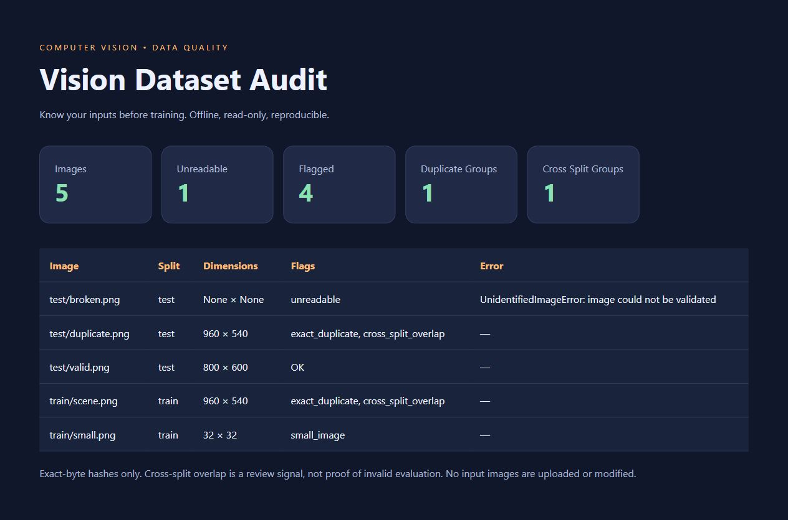

# Vision Dataset Audit

An offline Python computer-vision dataset inspection tool. Check image health and exact-byte duplicates before preparing a training/evaluation split.



## Status

Runnable bounded learning demonstration, AI-assisted and reviewed through automated tests. Not a research publication, production dataset certification or robotics deployment. Nine tests and a synthetic demo executed on October 4, 2026. The preview is an actual browser screenshot of the generated report, not a conceptual mockup.

## What it does

- Recursively inventories PNG/JPEG/BMP/WebP/TIFF images, skipping symlink files.
- Checks image structure and pixel decoding; flags unreadable files and configured pixel-limit violations.
- Records dimensions, mode, relative path and SHA-256 hash.
- Flags images below a configurable minimum side length.
- Groups exact-byte duplicates and highlights groups spanning top-level split folders.
- Exports JSON, CSV and a responsive, self-contained HTML report without uploading images or modifying inputs.
- Refuses to overwrite an existing output directory.

## Setup and example

Python 3.12+ recommended. Tested with Python 3.12 and Pillow 12.3.0.

```sh
python -m venv .venv
# Windows: .venv\Scripts\activate
# Linux/macOS: source .venv/bin/activate
python -m pip install -r requirements.txt
python demo.py
python audit.py demo-input demo-report
python -m unittest -v
```

Open `demo-report/index.html` in a browser. Demo generation refuses to overwrite `demo-input`; choose fresh locations for repeated runs. For your own data:

```sh
python audit.py /path/to/dataset /path/to/new-report --min-size 64 --max-pixels 20000000
```

The output directory must be outside the input dataset. Recommended layout is `dataset/train/...` and `dataset/test/...`; the first folder in each relative path is treated as its split. A nested class-only layout would instead be interpreted as different splits: arrange split folders correctly before interpreting overlap flags.

## Architecture

`audit.py`: deterministic inventory, validation, duplicate grouping, exporters and CLI. `demo.py`: original synthetic fixtures. `test_audit.py`: isolated temporary-directory regression tests. Configuration and summary are persisted in `report.json`; images remain local and are not embedded in the report.

## Verified demo

Five synthetic files: one corrupt file, one small image, a duplicate pair across train/test, and one valid independent image. Actual output: 5 images, 1 unreadable, 4 flagged, 1 duplicate group, 1 cross-split group. These are fixture checks, not measured model or robot performance.

## Limitations and robot-perception direction

Exact-byte hashing misses visually identical images with different encodings or metadata. This tool does not measure blur, annotate objects, detect semantic duplication or establish whether a dataset split is statistically valid. Cross-split overlap is a review signal, not proof of evaluation leakage. It scans still images only and hashes full file contents; huge datasets need additional throughput and resource controls. No recursive directory-symlink traversal is intended; use trusted local datasets. Reports expose local relative filenames: review before sharing.

This is a computer-vision data-quality foundation while learning toward robot perception. Camera calibration, temporal evaluation and perception models are future distinct projects, not features claimed here.

## Sources and provenance

Image opening/verification/decoding APIs checked against [official Pillow documentation](https://pillow.readthedocs.io/en/stable/reference/Image.html). Demo images are original programmatically generated geometric fixtures, no third-party dataset or pretrained model. Source and fixtures: MIT license. AI-assisted implementation; no client work or robotics experience claimed.
